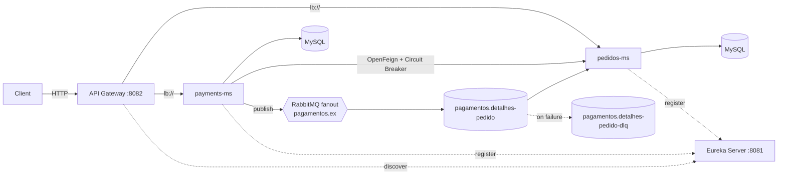

# API Gateway

Single entry point for the microservices, built with **Spring Cloud Gateway** and **Eureka service discovery**. Routes are created automatically from the services registered in Eureka, with client-side load balancing across instances.

  

## Tech stack
- Java 17, Spring Boot 3.2, Spring Cloud 2023.0
- Spring Cloud Gateway (reactive)
- Spring Cloud Netflix Eureka Client
- Maven

## Routing
Discovery locator is enabled with lower-case service ids, so each registered service is exposed under its own name:

```
http://localhost:8082/pedidos-ms/pedidos
http://localhost:8082/payments-ms/payments
```

Calling `GET http://localhost:8082/pedidos-ms/pedidos/porta` several times with multiple Orders instances running shows the gateway balancing requests between them.

## Architecture

This service is part of a small **food-delivery backend built with Java and Spring Cloud microservices**:

| Repository | Responsibility | Default port |
|---|---|---|
| [spring-microservices-eureka-server](https://github.com/gomeschristopher/spring-microservices-eureka-server) | Service registry (Netflix Eureka) | `8081` |
| [spring-microservices-gateway-api](https://github.com/gomeschristopher/spring-microservices-gateway-api) | API Gateway (Spring Cloud Gateway) with discovery-based routing | `8082` |
| [spring-microservices-orders-api](https://github.com/gomeschristopher/spring-microservices-orders-api) | Orders REST API (`pedidos-ms`) | `8080` (default) |
| [spring-microservices-payments-api](https://github.com/gomeschristopher/spring-microservices-payments-api) | Payments REST API (`payments-ms`) | random (`server.port=0`) |



**Communication patterns**
- **Synchronous:** Payments calls Orders through an **OpenFeign** client resolved by Eureka, protected by a **Resilience4j circuit breaker** with a fallback.
- **Asynchronous:** when a payment is created, Payments publishes an event to a **RabbitMQ fanout exchange**; Orders consumes it with listener retries and a **dead-letter queue**.

## Running locally

Prerequisites: JDK 17 and the Eureka Server running on `localhost:8081`.

```bash
./mvnw spring-boot:run   # starts on port 8082
```

## About this project

Study project built while following Alura's microservices training (example domain: *AluraFood*), used to practice service discovery, API gateway routing, inter-service communication, resilience and messaging with the Spring ecosystem.

**Author:** Christopher Gomes — [LinkedIn](https://www.linkedin.com/in/christophgomes/) · [GitHub](https://github.com/gomeschristopher)
